# Database Design & Schema Architecture

**Project Name:** Devia  
**Database Type:** Google Cloud Firestore (NoSQL Document Store)  
**Storage Type:** Google Cloud Storage (Firebase Storage)

---

## 1. Architectural Overview

Devia uses **Google Cloud Firestore**, a NoSQL document-oriented database, for high scalability, offline synchronization support, and real-time updates.

Unlike relational databases (SQL), Firestore uses a hierarchical structure consisting of **Collections**, **Documents**, and **Subcollections**. In our design:
* **Collections** (e.g., `users`, `rides`, `generatedRoutes`, `deviations`, `events`) contain independent documents.
* **Subcollections** (e.g., `rides/{rideId}/map`, `rides/{rideId}/annotations`) allow nested relationships.
* **Reference IDs** are used to create logical links (foreign keys) between collections.

### Smart Design Detail: Handling GPS Logs
Firestore documents have a maximum size limit of **1MB**. A GPS log for a long delivery ride can easily contain thousands of coordinates, which could cause a single document to exceed this limit.
* **Our Solution:** We isolate the detailed GPS coordinate array (`items: RidePoint[]`) in a fixed subcollection document at `/rides/{rideId}/map/points`. This keeps the main `/rides/{rideId}` document lightweight, cheap to list-query, and safe from document size limits.

---

## 2. Entity-Relationship Diagram (ERD) 
Last changed: 02/11/2026
Although Firestore is NoSQL, the logical relationships between data models can be visualized using a relational ERD.

```mermaid
erDiagram
    users {
        string userId PK "Document ID (Auth UID)"  
        string riderCode
        string preferredName  ""    
        varchar phone UK "varchar(11) - 09xxxxxxxxx"  
        enum gender  "Male, Female, Prefer not to say, Other"  
        enum ageRange  "18–24, 25–34, 35–44, 45–54, 55+"  
        enum city  "NCR municipality/city"  
        enum yearsExperience  "Less than 6 months, 6 months–1 year, 1–3 years, 3–5 years, More than 5 years"  
        string deliveryPlatform  "Grab, Foodpanda, Lalamove, JoyRide, Angkas, Borzo, Other"    
        boolean acceptedPolicies  ""  
        string createdAt  "ISO 8601 string" 
        string updatedAt  "ISO 8601 string" 
    }

    riderCodes {
        string codeId PK "Document ID (6-digit code)"
        boolean isClaimed
        string claimedBy FK "Points to users document ID"
        varchar phone
        number claimedAt "Unix Timestamp ms"
    }

    rides {
        string id PK "Auto-generated UUID (also stored as field)"
        string userId FK "Points to users document ID"
        string rideName
        number startTime "Unix Timestamp ms"
        number endTime "Unix Timestamp ms"
        int duration "Seconds"
        number distance "Meters"
        number suggestedRouteDistanceM "Meters"
        number suggestedRouteDurationSec "Seconds"
        number averageSpeed "m/s"
        number maxSpeed "m/s"
        number elevationGain "Meters"
        int deviationCount
        number createdAt "Unix Timestamp ms"
    }

    map_points {
        string pointsId PK "Fixed document ID: 'points' (not stored as field)"
        string rideId FK "Parent rides document ID (in path)"
        array items "Array of RidePoint coordinate objects"
        number latitude "coordinate.latitude"
        number longitude "coordinate.longitude"
        number timestamp "Unix Timestamp ms"
        number elevation "Meters (optional)"
        number heading "Degrees 0-360 (optional)"
        number accuracy "Meters (optional)"
    }
    
    postTripQuestionnaire_response {
        string rideId PK "Same as parent rides document ID"
        string arrival "Early, On time, Late"
        number etaRating
        number stressRating
        string language "en, tl"
        number submittedAt
    }

    generatedRoutes {
        string routeId PK "route-{timestamp}-{random} (stored as field)"
        string rideId FK "Points to rides document ID"
        enum type "Initial Route, Regenerated Route, Traffic Update"
        array routePoints "Generated route GPS coordinate array ({ lng, lat })"
        number sequence "Route generation order index"
        number generatedAt "Unix Timestamp ms"
        number remainingTravelTimeOriginal "in seconds (nullable for Initial Route)"
        number remainingTravelTimeNew "in seconds"
        number remainingDistanceOriginal "in meters (nullable for Initial Route)"
        number remainingDistanceNew "in meters"
    }

    deviations {
        string deviationId PK "dev-{rideId}-{index} (stored as field)"
        string routeId FK "Points to generatedRoutes document ID (nullable)"
        string rideId FK "Points to rides document ID"
        string userId FK "Points to users document ID"
        boolean isFaster "Nullable"
        string dateTime "ISO 8601 string or Unix ms fallback"
        string gpsLocation "lat,lng string (nullable)"
        string originalRouteEdge "Mirrors generatedInstruction (nullable)"
        string deviatedEdge "Mirrors deviationInstruction (nullable)"
        string streetName "Nullable"
        string generatedInstruction "Nullable"
        string deviationInstruction "Nullable"
        array points "GPS coordinates of the deviation"
        number timestamp "Unix ms"
        number createdAt "Unix Timestamp ms"
    }

    studyParticipants {
        string userId PK "Firebase Auth UID (document ID)"
        string studyId "Hardcoded static string"
        boolean acceptedTerms  ""  
        boolean acceptedPrivacy  ""  
        boolean acceptedDataUsage ""
        enum status  "joined, removed"  
        number joinedAt "Unix Timestamp ms"
        number updatedAt "Unix Timestamp ms"
    }

    tickets {
        string ticketId PK "Auto-generated UUID (document ID)"
        string userId FK "Points to users document ID"
        string subject
        string description
        enum status "pending, resolved"
        number createdAt "Unix Timestamp ms"
    }

    deviationResponses {
        string responseId PK "UUID"
        string deviationId FK "Points to deviations document ID"
        string rideId FK "Points to rides document ID"
        enum primaryReason ""
        string primaryReasonOther
        enum trafficSeverity "1 = Very Light, 2 = Light, 3 = Moderate, 4 = Heavy, 5 = Severe"
        enum rushHourCause "Yes, No, Unsure"
        enum chooseDuringNonRush "Yes, No, Unsure"
        enum blockageReason "Flood, Accident, Road closure, Illegal parking, Other"
        string blockageReasonOther 
        array personalStopReason
        string personalStopOther
        enum stopDuration "optional enum"
        enum deviateAgain "Always, Often, Sometimes, Rarely, Never"
        enum avoidRoadFrequency "Always, Often, Sometimes, Rarely, Never, I don't usually pass here"
        string language "en, tl"
        number submittedAt "Unix Timestamp ms"
        number createdAt "Unix Timestamp ms"
    }

    annotations {
        string id PK "Auto-generated UUID (stored as field)"
        string rideId FK "Points to rides document ID"
        string userId FK "Points to users document ID"
        string annotationId "Predefined annotation type ID"
        enum type "point, segment"
        array points "Array of RidePoint coordinate objects"
        string mediaUri "Cloud Storage download URL"
        string mediaType "image, video, audio"
        string sentiment "positive, negative, neutral"
        array additionalTags "Optional string tags"
        array autoGeneratedAnnotations "Auto-inferred annotations"
        boolean autoAnnotationSeen
        string source "auto-generated-from-video"
        number timestamp "Unix Timestamp ms"
        number start_timestamp "Unix Timestamp ms"
        number end_timestamp "Unix Timestamp ms"
        number createdAt "Unix Timestamp ms"
    }

    compensationClaims {
        string userId PK "Firebase Auth UID (document ID)"
        string email
        enum paymentMethod "gcash, maya, gotyme"
        string accountName
        string accountNumber
        varchar phoneNumber
        enum status "pending_validation, ready_to_claim, paid, rejected"
        string referenceNumber
        int recordedSubmissions
        number amount
        number createdAt "Unix Timestamp ms"
        number updatedAt "Unix Timestamp ms"
    }

    adminNotifications {
        string notificationId PK "Document ID (quota-{uid} or auto UUID)"
        enum type "quota_reached_ready_for_cross_check, compensation_claim_ready_for_validation"
        string userId FK "Points to users document ID"
        string email
        int recordedSubmissions
        int requiredSubmissions
        string referenceNumber
        number amount
        enum status "unread, read"
        timestamp createdAt "Firestore serverTimestamp"
    }

    events {
        string id PK "Auto-generated UUID (document ID)"
        string eventName
        string eventDescription
        number eventDate "Unix Timestamp ms"
        array eventMedia "Array of media URLs"
        string eventLocation
        string eventOrganizer
        string eventOrganizerEmail
        string eventOrganizerPhone
        number createdAt "Unix Timestamp ms"
    }

    app_version {
        string docId PK "Fixed document ID: 'current'"
        string version "Semantic version string"
        string updatedAPKUrl "Download URL for latest Android APK"
    }

    local_accounts {
        string phone PK "Text"
        string rider_code "Text (Nullable)"
        string preferred_name "Text"
        string gender "Text"
        string age_range "Text"
        string city "Text"
        string years_experience "Text"
        number accepted_policies "Integer"
        string created_at "Text"
    }

    rider_code_registrations {
        string code PK "Text"
        string phone FK "Points to local_accounts.phone"
        string registered_at "Text"
    }

    recent_destinations {
        string user_id PK "Text (Firebase Auth UID or 'anonymous')"
        string name PK "Text"
        number longitude PK "Real"
        number latitude PK "Real"
        string full_address "Text"
        string updated_at "Text"
    }

    users ||--o{ rides : "records"
    users ||--o| riderCodes : "claims"
    users ||--o| studyParticipants : "enrolls as"
    users ||--o| compensationClaims : "submits claim"
    users ||--o{ adminNotifications : "triggers"
    users ||--o{ tickets : "creates"
    users ||--o{ recent_destinations : "saves destinations"
    rides ||--|| map_points : "stores GPS in"
    rides ||--o{ annotations : "contains annotations"
    rides ||--o{ generatedRoutes : "generates routes during trip"
    generatedRoutes ||--o{ deviations : "contains deviation markers"
    deviations ||--o| deviationResponses : "collects user feedback via"
    rides ||--o| postTripQuestionnaire_response : "submits questionnaire"
    rides ||--o{ deviations : "directly detects deviations"
    local_accounts ||--o| rider_code_registrations : "registers rider code"
```



---

## 3. Data Dictionary (Schema Specifications)

### 3.1. Collection: `users`
* **Path:** `/users/{userId}`
* **Document ID:** Firebase Auth UID. The document ID acts as the primary key; a separate `id` field is **not** stored in the Firestore document itself.
* **Purpose:** Stores profile details and onboarding survey information of the rider.

Last changed: 02/11/2026
| Field Name | Data Type | Required | Description / Constraints |
| :--- | :--- | :--- | :--- |
| `userId` | String | (Doc ID) | Firebase Auth UID. Not stored as field. |
| `riderCode` | String | Yes | Unique rider code assigned to the participant for the study |
| `preferredName` | String | Yes | Rider's preferred display name shown within the application |
| `phone` | Varchar(11) | Yes | 11-digit Philippine mobile number, format: `09xxxxxxxxx` |
| `gender` | Enum | Yes | Gender identity (`'Male'`, `'Female'`, `'Prefer not to say'`, `'Other'`) |
| `ageRange` | Enum | Yes | Age range category (`'18–24'`, `'25–34'`, `'35–44'`, `'45–54'`, `'55+'`) |
| `city` | Enum | Yes | Municipality/City where the rider primarily performs deliveries |
| `yearsExperience` | Enum | Yes | Experience range (`'Less than 6 months'`, `'6 months–1 year'`, `'1–3 years'`, `'3–5 years'`, `'More than 5 years'`; or `'Less than 1 year'`, `'1 – 3 Years'`, `'3 – 5 Years'`, `'More than 5 years'`) |
| `deliveryPlatform` | String | Yes | Primary delivery platform used (`'Grab'`, `'Foodpanda'`, `'Lalamove'`, `'JoyRide'`, `'Angkas'`, `'Borzo'`, `'Other'`) |
| `acceptedPolicies` | Boolean | Yes | Must be `true`; agreed to Terms of Service & Privacy Policy |
| `createdAt` | String | Yes | ISO 8601 string when the user account was created |
| `updatedAt` | String | Yes | ISO 8601 string when the profile was last updated |
---

### 3.2. Collection: `rides`
* **Path:** `/rides/{rideId}`
* **Document ID:** Auto-generated UUID. The `id` field is also written into the document body.
* **Purpose:** Stores summary stats of a completed delivery trip.

Last changed: 16/09/2026
| Field Name | Data Type | Required | Description / Constraints |
| :--- | :--- | :--- | :--- |
| `id` | String | Yes | Same as the document ID |
| `userId` | String | Yes | Foreign key — the Firebase Auth UID of the rider |
| `rideName` | String | Yes | Name given to the trip |
| `startTime` | Number | Yes | Unix timestamp (ms) when the ride started |
| `endTime` | Number | Yes | Unix timestamp (ms) when the ride ended |
| `duration` | Int | Yes | Total ride time in seconds |
| `distance` | Number | Yes | Total distance traveled in meters |
| `suggestedRouteDistanceM` | Number | Yes | Suggested route distance in meters |
| `suggestedRouteDurationSec` | Number | Yes | Suggested route duration in seconds |
| `averageSpeed` | Number | Yes | Average speed in m/s |
| `maxSpeed` | Number | Yes | Peak speed in m/s |
| `elevationGain` | Number | Yes | Total elevation gain in meters |
| `deviationCount` | Int | Yes | Total number of deviations detected during the ride |
| `createdAt` | Number | Yes | Unix timestamp (ms) of when the ride record was created |
---

### 3.3. Subcollection: `map` → Document: `points` (Under `rides`)
* **Path:** `/rides/{rideId}/map/points`
* **Document ID:** Static, always `"points"`.
* **Purpose:** Stores the full GPS breadcrumb trail separately from the summary document to stay within Firestore's 1 MB document size limit.
  
Last changed: 02/11/2026
| Field Name | Data Type | Required | Description / Constraints |
| :--- | :--- | :--- | :--- |
| `pointsId` | String | (Doc ID) | Static document ID `"points"`. Not stored as a field inside the document. |
| `rideId` | String | (Parent ID) | Parent ride document ID in path `/rides/{rideId}/map/points`. Not stored as a field inside the document. |
| `items` | Array (Object) | Yes | Ordered list of `RidePoint` coordinate objects |

RidePoint Object
| Field Name | Data Type | Required | Description / Constraints |
| :--- | :--- | :--- | :--- |
| `coordinate.latitude` | Number | Yes | Latitude coordinate of the recorded GPS point |
| `coordinate.longitude` | Number | Yes | Longitude coordinate of the recorded GPS point |
| `timestamp` | Number | Yes | Unix timestamp (ms) when the GPS point was recorded |
| `elevation` | Number | No | Elevation (meters) at the recorded GPS point |
| `heading` | Number | No | Compass heading in degrees (`0–360`) at the recorded GPS point |
| `accuracy` | Number | No | Horizontal GPS accuracy radius in meters |

#### `RidePoint` Object Shape
```json
{
  "coordinate": {
    "latitude": 14.598720,
    "longitude": 120.984222
  },
  "timestamp": 1720345678000,
  "elevation": 45.2,
  "heading": 180.0,
  "accuracy": 4.5
}
```

---

### 3.4. Collection: `generatedRoutes`
* **Path:** `/generatedRoutes/{routeId}`
* **Document ID:** Generated string in format `route-{timestamp}-{random}`. The `routeId` field is also written into the document body.
* **Purpose:** Stores each generated route during a trip. A new route is generated every time a rider deviates from the previous one — multiple generated routes are expected per trip (e.g., initial route → deviation → route 2 → deviation → route 3, and so on).

Last changed: 02/11/2026
| Field Name | Data Type | Required | Description / Constraints |
| :--- | :--- | :--- | :--- |
| `routeId` | String | Yes | Same as the document ID (`route-{timestamp}-{random}`) |
| `rideId` | String | Yes | Parent ride document ID (foreign key referencing `rides.id`) |
| `type` | Enum | Yes | Type of generated route (`'Initial Route'`, `'Regenerated Route'`, or `'Traffic Update'`) |
| `routePoints` | Array (Object) | Yes | Ordered list of `{ lng: number, lat: number }` coordinate objects representing the generated navigation route |
| `sequence` | Number | Yes | Route generation order index (`1` = initial route, `2` = first regenerated route, etc.) |
| `generatedAt` | Number | Yes | Unix timestamp (ms) when the route was generated |
| `remainingTravelTimeOriginal` | Number | No | Remaining travel time in seconds on the previous route before regeneration (`null` for `'Initial Route'`) |
| `remainingTravelTimeNew` | Number | Yes | Remaining travel time in seconds on the newly generated route |
| `remainingDistanceOriginal` | Number | No | Remaining distance in meters on the previous route before regeneration (`null` for `'Initial Route'`) |
| `remainingDistanceNew` | Number | Yes | Remaining distance in meters on the newly generated route |
---

### 3.5. Collection: `deviations`
* **Path:** `/deviations/{deviationId}`
* **Document ID:** Generated string in format `dev-{rideId}-{index}`. The `deviationId` field is also written into the document body.
* **Purpose:** Stores each deviation marker the rider tagged during or after the trip, linked to the specific generated route that was active when the deviation occurred.

Last changed: 02/11/2026
| Field Name | Data Type | Required | Description / Constraints |
| :--- | :--- | :--- | :--- |
| `deviationId` | String | Yes | Same as the document ID (`dev-{rideId}-{index}`) |
| `routeId` | String | No | Parent route document ID (foreign key referencing `generatedRoutes.routeId`, nullable) |
| `rideId` | String | Yes | Parent ride document ID (foreign key referencing `rides.id`) |
| `userId` | String | Yes | Foreign key referencing `users.userId` (Firebase Auth UID of the rider) |
| `isFaster` | Boolean | No | Indicates if the deviation resulted in a faster route (nullable) |
| `dateTime` | String / Number | Yes | ISO 8601 string indicating when the deviation occurred (or Unix timestamp ms fallback) |
| `gpsLocation` | String | No | Comma-separated `"latitude,longitude"` coordinate where the rider deviated (nullable) |
| `originalRouteEdge` | String | No | Mirrors `generatedInstruction` describing the suggested route maneuver/edge (nullable) |
| `deviatedEdge` | String | No | Mirrors `deviationInstruction` describing the actual maneuver/edge taken (nullable) |
| `streetName` | String | No | Name of the road where the deviation occurred (nullable) |
| `generatedInstruction` | String | No | Navigation instruction generated by the routing engine immediately before the deviation occurred (nullable) |
| `deviationInstruction` | String | No | Actual maneuver performed by the rider instead of the generated navigation instruction (nullable) |
| `points` | Array (Object) | Yes | Array of `{ latitude, longitude }` objects representing the deviation location |
| `timestamp` | Number | Yes | Unix timestamp (ms) when the deviation occurred |
| `createdAt` | Number | Yes | Unix timestamp (ms) when the record was created |
---

### 3.6. Collection: `deviationResponses`
* **Path:** `/deviationResponses/{responseId}`
* **Document ID:** Auto-generated UUID. The `responseId` field is also written into the document body.
* **Purpose:** Stores the rider's questionnaire responses describing the reason and circumstances for a recorded route deviation.

Last changed: 02/11/2026
| Field Name | Data Type | Required | Description / Constraints |
| :--- | :--- | :--- | :--- |
| `responseId` | String | Yes | Same as the document ID |
| `deviationId` | String | Yes | Foreign key referencing `deviations.deviationId` |
| `rideId` | String | Yes | Foreign key referencing `rides.id` |
| `primaryReason` | Enum | Yes | Primary reason selected by the rider for deviating from the generated route |
| `primaryReasonOther` | String | No | User-specified primary reason when `"Other"` is selected in `primaryReason` |
| `trafficSeverity` | Enum | No | Reported traffic severity (`'1 = Very Light'`, `'2 = Light'`, `'3 = Moderate'`, `'4 = Heavy'`, `'5 = Severe'`) |
| `rushHourCause` | Enum | No | Whether rush hour contributed to the deviation (`'Yes'`, `'No'`, `'Unsure'`) |
| `chooseDuringNonRush` | Enum | No | Whether the rider would choose the same route during non-rush-hour conditions (`'Yes'`, `'No'`, `'Unsure'`) |
| `blockageReason` | Enum | No | Type of road blockage or hazard encountered (`'Flood'`, `'Accident'`, `'Road closure'`, `'Illegal parking'`, `'Other'`) |
| `blockageReasonOther` | String | No | User-specified explanation of the blockage when `"Other"` is selected |
| `personalStopReason` | Array (String) | No | One or more reasons for making a personal stop |
| `personalStopOther` | String | No | User-specified reason for the personal stop when `"Other"` is selected |
| `stopDuration` | Enum | No | Approximate duration of the personal stop |
| `deviateAgain` | Enum | Yes | Likelihood of deviating again under similar circumstances (`'Always'`, `'Often'`, `'Sometimes'`, `'Rarely'`, `'Never'`) |
| `avoidRoadFrequency` | Enum | Yes | Frequency with which the rider usually avoids the road (`'Always'`, `'Often'`, `'Sometimes'`, `'Rarely'`, `'Never'`, `"I don't usually pass here"`) |
| `language` | String | Yes | ISO language code of the questionnaire completed by the rider (`'en'` or `'tl'`) |
| `submittedAt` | Number | Yes | Unix timestamp (ms) when the questionnaire was submitted |
| `createdAt` | Number | Yes | Unix timestamp (ms) when the response record was created |
---

### 3.7. Collection: `postTripQuestionnaire_response`
* **Path:** `/postTripQuestionnaire_response/{rideId}`
* **Document ID:** The parent `rideId` is used as the document ID.
* **Purpose:** Stores the rider's responses to the post-trip questionnaire completed after finishing a ride.

Last changed: 02/11/2026
| Field Name | Data Type | Required | Description / Constraints |
| :--- | :--- | :--- | :--- |
| `rideId` | String | Yes | Foreign key referencing `rides.id` (also acts as document ID) |
| `arrival` | Enum | Yes | Rider's perceived arrival status (`'Early'`, `'On time'`, `'Late'`) |
| `etaRating` | Number | Yes | Rider's rating of the estimated arrival time (ETA) (`1–5`) |
| `stressRating` | Number | Yes | Rider's self-reported stress level during the trip (`1–5`) |
| `language` | String | Yes | ISO language code of the questionnaire completed by the rider (`'en'` or `'tl'`) |
| `submittedAt` | Number | Yes | Unix timestamp (ms) when the questionnaire was submitted |
---

### 3.8. Collection: `studyParticipants`
* **Path:** `/studyParticipants/{userId}`
* **Document ID:** Firebase Auth UID. A rider can only enroll in 1 study (document ID matches user ID).
* **Purpose:** Tracks which riders have consented to and enrolled in the research study.

Last changed: 15/09/2026
| Field Name | Data Type | Required | Description / Constraints |
| :--- | :--- | :--- | :--- |
| `userId` | String | Yes | Firebase Auth UID (document ID) |
| `studyId` | String | Yes | Hardcoded static string (e.g., 'devia-route-study' or 'devia-route') |
| `acceptedTerms` | Boolean | Yes |  |
| `acceptedPrivacy` | Boolean | Yes |  |
| `acceptedDataUsage` | Boolean | No |  |
| `status` | String | Yes | Enum: `'joined'`, `'removed'` |
| `joinedAt` | Number | Yes | Unix Timestamp ms |
| `updatedAt` | Number | Yes | Unix Timestamp ms |

---

### 3.9. Collection: `tickets`
* **Path:** `/tickets/{ticketId}`
* **Document ID:** Auto-generated UUID.
* **Purpose:** Stores helpdesk/support requests submitted by riders from the in-app support screen.
* **Note:** The document ID is not saved as a field inside the document body.

Last changed: 15/09/2026
| Field Name | Data Type | Required | Description / Constraints |
| :--- | :--- | :--- | :--- |
| `ticketId` | String | (Doc ID) | Auto-generated UUID. Not stored as field. |
| `userId` | String | Yes | Firebase Auth UID of the submitter |
| `subject` | String | Yes | Brief summary of the support issue |
| `description` | String | Yes | Full description of the problem |
| `status` | String | Yes | Always `'pending'` on creation; updated by admin |
| `createdAt` | Number | Yes | Unix timestamp (ms) of submission |

---

### 3.10. Subcollection: `annotations` (Under `rides`)
* **Path:** `/rides/{rideId}/annotations/{annotationId}`
* **Document ID:** Auto-generated UUID. The `id` field is also written into the document body.
* **Purpose:** Stores point or segment road/traffic annotations and optional media captured during a ride.

Last changed: 02/11/2026
| Field Name | Data Type | Required | Description / Constraints |
| :--- | :--- | :--- | :--- |
| `id` | String | Yes | Same as the document ID |
| `rideId` | String | Yes | Parent ride document ID (foreign key referencing `rides.id`) |
| `userId` | String | Yes | Foreign key referencing `users.userId` (Firebase Auth UID) |
| `annotationId` | String | Yes | Identifier of the predefined annotation type |
| `type` | Enum | Yes | Annotation geometry type (`'point'` or `'segment'`) |
| `points` | Array (Object) | Yes | Array of `RidePoint` coordinate objects associated with the annotation |
| `mediaUri` | String | No | Firebase Cloud Storage download URL for attached media (`null` if none) |
| `mediaType` | String | No | Media MIME/category type (`null` if none) |
| `sentiment` | String | No | Optional rider sentiment tag |
| `additionalTags` | Array (String) | No | Optional array of additional descriptive tags |
| `autoGeneratedAnnotations` | Array (Object) | No | Optional auto-inferred annotations from ride video |
| `autoAnnotationSeen` | Boolean | No | Whether auto-generated annotations were reviewed |
| `source` | String | No | Optional source marker (e.g., `'auto-generated-from-video'`) |
| `timestamp` | Number | No | Unix timestamp (ms) for point annotations |
| `start_timestamp` | Number | No | Start Unix timestamp (ms) for segment annotations |
| `end_timestamp` | Number | No | End Unix timestamp (ms) for segment annotations |
| `createdAt` | Number | Yes | Unix timestamp (ms) when the annotation was saved |

---

### 3.11. Collection: `compensationClaims`
* **Path:** `/compensationClaims/{userId}`
* **Document ID:** Firebase Auth UID (`userId`).
* **Purpose:** Stores study compensation payout claims submitted by riders after completing the required number of trips.

Last changed: 02/11/2026
| Field Name | Data Type | Required | Description / Constraints |
| :--- | :--- | :--- | :--- |
| `userId` | String | Yes | Firebase Auth UID of the claimant (matches document ID) |
| `email` | String | No | Synthetic or registered email of the user (`null` if unavailable) |
| `paymentMethod` | Enum | Yes | Selected e-wallet payout provider (`'gcash'`, `'maya'`, `'gotyme'`) |
| `accountName` | String | Yes | Full name on the e-wallet account |
| `accountNumber` | String | Yes | Account number for payout |
| `phoneNumber` | Varchar | Yes | Philippine mobile number (`09xxxxxxxxx`) |
| `status` | Enum | Yes | Claim validation status (`'pending_validation'`, `'ready_to_claim'`, `'paid'`, `'rejected'`) |
| `referenceNumber` | String | Yes | Generated claim reference code (`DEVIA-YYYYMMDD-XXXXXX`) |
| `recordedSubmissions` | Int | Yes | Number of recorded ride submissions at the time of claim |
| `amount` | Number | Yes | Compensation payout amount (e.g., `250`) |
| `createdAt` | Number | Yes | Unix timestamp (ms) when the claim was created |
| `updatedAt` | Number | Yes | Unix timestamp (ms) when the claim was last updated |

---

### 3.12. Collection: `adminNotifications`
* **Path:** `/adminNotifications/{notificationId}`
* **Document ID:** `quota-{userId}` for quota notifications, or auto-generated UUID for compensation claim notifications.
* **Purpose:** Stores system-generated notifications alerting research administrators when a rider reaches the trip quota or submits a compensation claim.

Last changed: 02/11/2026
| Field Name | Data Type | Required | Description / Constraints |
| :--- | :--- | :--- | :--- |
| `notificationId` | String | (Doc ID) | Document ID (`quota-{uid}` or auto-generated UUID). Not stored as field. |
| `type` | Enum | Yes | Notification event type (`'quota_reached_ready_for_cross_check'` or `'compensation_claim_ready_for_validation'`) |
| `userId` | String | Yes | Foreign key referencing `users.userId` |
| `email` | String | No | User's email address (`null` if unavailable) |
| `recordedSubmissions` | Int | Yes | Total recorded rides submitted by the user |
| `requiredSubmissions` | Int | No | Required ride quota (present on quota notifications) |
| `referenceNumber` | String | No | Associated claim reference number (present on claim notifications) |
| `amount` | Number | No | Claim amount (present on claim notifications) |
| `status` | Enum | Yes | Notification read state (initialized as `'unread'`) |
| `createdAt` | Timestamp | Yes | Firestore `serverTimestamp()` when the notification was created |

---

### 3.13. Collection: `events`
* **Path:** `/events/{eventId}`
* **Document ID:** Auto-generated UUID.
* **Purpose:** Stores community and study events published by administrators for riders to view in the app.

Last changed: 02/11/2026
| Field Name | Data Type | Required | Description / Constraints |
| :--- | :--- | :--- | :--- |
| `id` | String | (Doc ID) | Auto-generated UUID (mapped to `id` on fetch) |
| `eventName` | String | Yes | Title of the event |
| `eventDescription` | String | Yes | Full description of the event |
| `eventDate` | Number | Yes | Unix timestamp (ms) of the event date |
| `eventMedia` | Array (String) | No | Optional list of image/media URLs for the event |
| `eventLocation` | String | Yes | Physical or virtual location of the event |
| `eventOrganizer` | String | Yes | Name of the organizing person or team |
| `eventOrganizerEmail` | String | Yes | Contact email of the organizer |
| `eventOrganizerPhone` | String | Yes | Contact phone number of the organizer |
| `createdAt` | Number | Yes | Unix timestamp (ms) when the event was created |

---

### 3.14. Collection: `app_version`
* **Path:** `/app_version/{docId}`
* **Document ID:** Fixed document ID `"current"`.
* **Purpose:** Stores the latest released mobile application version and APK download link for in-app update prompts on Android.

Last changed: 02/11/2026
| Field Name | Data Type | Required | Description / Constraints |
| :--- | :--- | :--- | :--- |
| `docId` | String | (Doc ID) | Fixed string `"current"`. Not stored as field. |
| `version` | String | Yes | Latest semantic version string (compared against `Constants.expoConfig.version`) |
| `updatedAPKUrl` | String | No | URL to download the latest Android APK build |

---

### 3.15. Collection: `riderCodes`
* **Path:** `/riderCodes/{codeId}`
* **Document ID:** 6-digit alphanumeric rider invitation code.
* **Purpose:** Tracks pre-generated study invitation codes and whether they have been claimed by a registered rider.

Last changed: 02/11/2026
| Field Name | Data Type | Required | Description / Constraints |
| :--- | :--- | :--- | :--- |
| `codeId` | String | (Doc ID) | 6-digit rider invitation code. Acts as document ID. |
| `isClaimed` | Boolean | Yes | `true` once a rider has registered with this code |
| `claimedBy` | String | No | Foreign key referencing `users.userId` of the rider who claimed the code |
| `phone` | Varchar | No | Philippine mobile number (`09xxxxxxxxx`) of the rider who claimed the code |
| `claimedAt` | Number | No | Unix timestamp (ms) when the code was claimed |

---

### 3.16. SQLite Table: `local_accounts`
* **Database:** Local SQLite (`devia-local.db`, with AsyncStorage fallback)
* **Primary Key:** `phone` (User's Philippine mobile number).
* **Purpose:** Stores the local on-device account and onboarding information of riders.

Last changed: 02/11/2026
| Field Name | Data Type | Required | Description / Constraints |
| :--- | :--- | :--- | :--- |
| `phone` | TEXT (PK) | Yes | Philippine mobile phone number used to identify the rider |
| `rider_code` | TEXT | No | Unique rider code assigned to the participant for the study (nullable) |
| `preferred_name` | TEXT | Yes | Rider's preferred display name shown within the application |
| `gender` | TEXT | Yes | Gender identity selected during onboarding |
| `age_range` | TEXT | Yes | Age range category (e.g., "18–24", "25–34") |
| `city` | TEXT | Yes | Municipality/City where the rider primarily performs deliveries |
| `years_experience` | TEXT | Yes | Experience range selected during onboarding |
| `accepted_policies` | INTEGER | Yes | Must be `1` (`true`); agreed to Terms of Service & Privacy Policy |
| `created_at` | TEXT | Yes | ISO 8601 string when the user account was created |
---

### 3.17. SQLite Table: `rider_code_registrations`
* **Database:** Local SQLite (`devia-local.db`, with AsyncStorage fallback)
* **Primary Key:** `code` (Rider registration code).
* **Purpose:** Stores registered rider codes and associates each code with the corresponding local rider account.

Last changed: 02/11/2026
| Field Name | Data Type | Required | Description / Constraints |
| :--- | :--- | :--- | :--- |
| `code` | TEXT (PK) | Yes | Unique rider registration code |
| `phone` | TEXT | Yes | Phone number of the associated rider. References `local_accounts.phone` |
| `registered_at` | TEXT | Yes | ISO 8601 timestamp indicating when the rider code was registered |
---

### 3.18. SQLite Table: `recent_destinations`
* **Database:** Local SQLite (`devia-local.db`, with AsyncStorage fallback)
* **Primary Key:** Composite key `(user_id, name, longitude, latitude)`.
* **Purpose:** Stores destinations recently searched for or selected by a rider, including their geographic coordinates and address information.

Last changed: 02/11/2026
| Field Name | Data Type | Required | Description / Constraints |
| :--- | :--- | :--- | :--- |
| `user_id` | TEXT (PK) | Yes | Firebase Auth UID (`users.userId`) of the rider (or `'anonymous'` if unauthenticated) |
| `name` | TEXT (PK) | Yes | Name or label of the destination |
| `longitude` | REAL (PK) | Yes | Geographic longitude of the destination |
| `latitude` | REAL (PK) | Yes | Geographic latitude of the destination |
| `full_address` | TEXT | Yes | Complete formatted address of the destination |
| `updated_at` | TEXT | Yes | ISO 8601 timestamp indicating when the destination record was last updated |

---

## 4. Storage Architecture (Firebase Cloud Storage)

Media files are stored in Firebase Storage using the following folder conventions:

| Storage Path | Associated With | Contents |
| :--- | :--- | :--- |
| `rides/{rideId}/annotations/{annotationId}` | `annotations` (`/rides/{rideId}/annotations/{annotationId}`) | Rider-captured annotation media (photos/videos) attached to a ride |

---

## 5. Security Rules Summary (`firestore.rules`)

Rules are defined in [firestore.rules](../firestore.rules) and follow the principle of least privilege:

| Collection | Read Rule | Write Rule |
| :--- | :--- | :--- |
| `users/{userId}` | Owner only (`auth.uid == userId`) | Owner only |
| `rides/{rideId}` | Owner only (`resource.data.userId == auth.uid`) | Create: authenticated + userId matches; Update/Delete: owner only |
| `rides/{rideId}/map/{docId}` | Owner only (via ride parent ownership check) | Owner only (via ride parent ownership check) |
| `rides/{rideId}/annotations/{annotationId}` | Owner only (via ride parent ownership check) | Owner only (via ride parent ownership check) |
| `generatedRoutes/{routeId}` | Any authenticated user | Any authenticated user |
| `deviations/{deviationId}` | Any authenticated user | Any authenticated user |
| `deviationResponses/{responseId}` | Any authenticated user | Any authenticated user |
| `postTripQuestionnaire_response/{rideId}` | Any authenticated user | Any authenticated user |
| `studyParticipants/{userId}` | Owner only (`auth.uid == userId`) | Owner only (`auth.uid == userId`) |
| `compensationClaims/{userId}` | Owner only (`auth.uid == userId`) | Owner only (`auth.uid == userId`) |
| `tickets/{ticketId}` | Owner only (`resource.data.userId == auth.uid`) | Authenticated users (`create` only where `userId == auth.uid`) |
| `adminNotifications/{id}` | **Nobody** (`allow read: if false`) | Authenticated users (`create` only) |
| `events/{eventId}` | Any authenticated user | **Nobody** (`allow write: if false`) |
| `app_version/{docId}` | **Everyone** (public, unauthenticated) | **Nobody** |
| `riderCodes/{codeId}` | **Everyone** (public, unauthenticated) | Any authenticated user |

